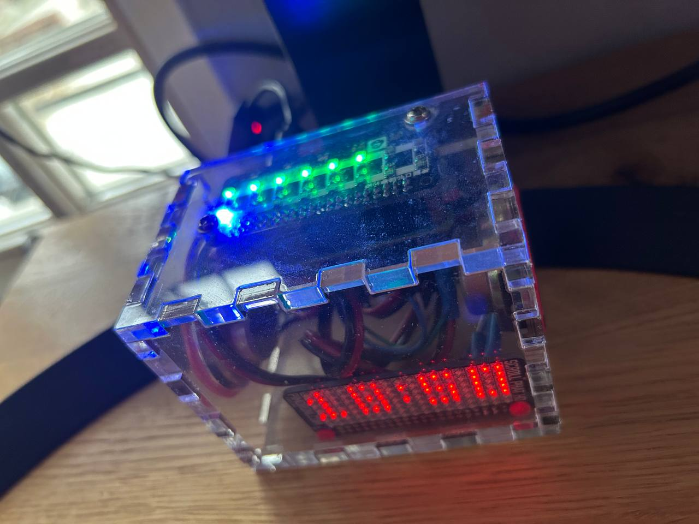
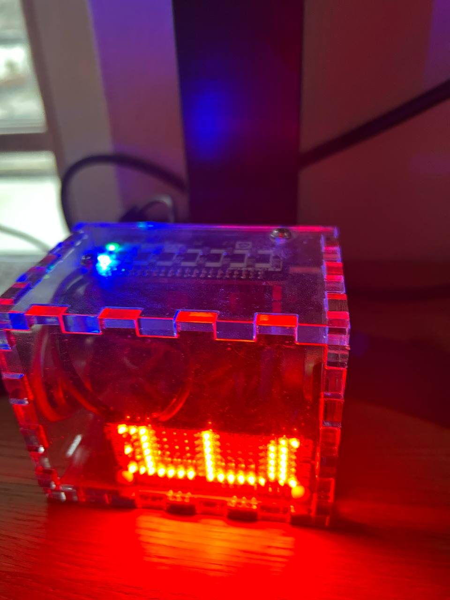

# raspiclock

Just a small python script to set up a clock I built some time ago.
It is a pizero + Pimoroni's scrollphat led and their phatbeat audio output.

I use it to show the day of the week, the percentage of the hour, the time
and for some long running jobs running on other machines to tell me they completed.





## Securing the POST endpoints

Both POST endpoints require an HMAC-SHA256 signature. Set `CLOCK_HMAC_SECRET`
on the clock, preferably with a systemd `EnvironmentFile` readable only by the
service user.

The signature is calculated over:

```text
METHOD
PATH
TIMESTAMP
BODY
```

`TIMESTAMP` must be Unix seconds. Requests more than 300 seconds old, or with
timestamps more than 300 seconds in the future, are rejected.

Example for `/receive`:

```sh
secret='replace-with-a-long-random-secret'
body='Job finished'
timestamp=$(date +%s)
signature=$(
  printf 'POST\n/receive\n%s\n%s' "$timestamp" "$body" |
    openssl dgst -sha256 -hmac "$secret" -hex |
    awk '{print $2}'
)

curl \
  -H "X-Timestamp: $timestamp" \
  -H "X-Signature: $signature" \
  --data-binary "$body" \
  http://clock:8080/receive
```

The same request with Ansible:

```yaml
- name: Send a signed request to the clock
  hosts: localhost
  gather_facts: false
  vars:
    clock_secret: replace-with-a-long-random-secret
    clock_body: Job finished
    clock_timestamp: "{{ lookup('ansible.builtin.pipe', 'date +%s') }}"
    signed_payload: "POST\n/receive\n{{ clock_timestamp }}\n{{ clock_body }}"
  tasks:
    - name: Calculate the HMAC-SHA256 signature
      ansible.builtin.command:
        argv:
          - openssl
          - dgst
          - -sha256
          - -hmac
          - "{{ clock_secret }}"
          - -hex
        stdin: "{{ signed_payload }}"
      register: signature_command
      changed_when: false
      no_log: true

    - name: POST the job message
      ansible.builtin.uri:
        url: http://clock:8080/receive
        method: POST
        body: "{{ clock_body }}"
        headers:
          X-Timestamp: "{{ clock_timestamp }}"
          X-Signature: "{{ signature_command.stdout.split()[-1] }}"
        status_code: 200
      no_log: true
```

For `/job`, replace `/receive` in the signed data with `/job`.

### Configure systemd

On the clock, create a root-owned environment file containing the secret:

```sh
sudo sh -c 'umask 077; printf "CLOCK_HMAC_SECRET=%s\n" "$(openssl rand -hex 32)" > /etc/clock.env'
sudo chown root:root /etc/clock.env
sudo chmod 600 /etc/clock.env
```

Create a systemd drop-in so the service loads that file:

```sh
sudo mkdir -p /etc/systemd/system/clock.service.d
printf '[Service]\nEnvironmentFile=/etc/clock.env\n' | sudo tee /etc/systemd/system/clock.service.d/hmac.conf >/dev/null
```

Reload systemd and restart the clock:

```sh
sudo systemctl daemon-reload
sudo systemctl restart clock
systemctl is-active clock
sudo systemctl show clock -p EnvironmentFiles
```

The expected output is `active` and:

```text
EnvironmentFiles=/etc/clock.env (ignore_errors=no)
```

The drop-in is separate from the main unit file, so it survives future
`make deploy` calls.

### Verify authentication

An unsigned request should return `401`:

```sh
curl -sS -o /dev/null -w '%{http_code}\n' \
  -X POST --data-binary 'unauthenticated' \
  http://127.0.0.1:8080/receive
```

A correctly signed request should return `200`:

```sh
sudo sh -c '
secret=$(sed -n "s/^CLOCK_HMAC_SECRET=//p" /etc/clock.env)
body="Job finished"
timestamp=$(date +%s)
signature=$(printf "POST\n/receive\n%s\n%s" "$timestamp" "$body" | openssl dgst -sha256 -hmac "$secret" -hex | cut -d" " -f2)
curl -sS -o /dev/null -w "%{http_code}\n" \
  -H "X-Timestamp: $timestamp" \
  -H "X-Signature: $signature" \
  --data-binary "$body" \
  http://127.0.0.1:8080/receive
'
```
